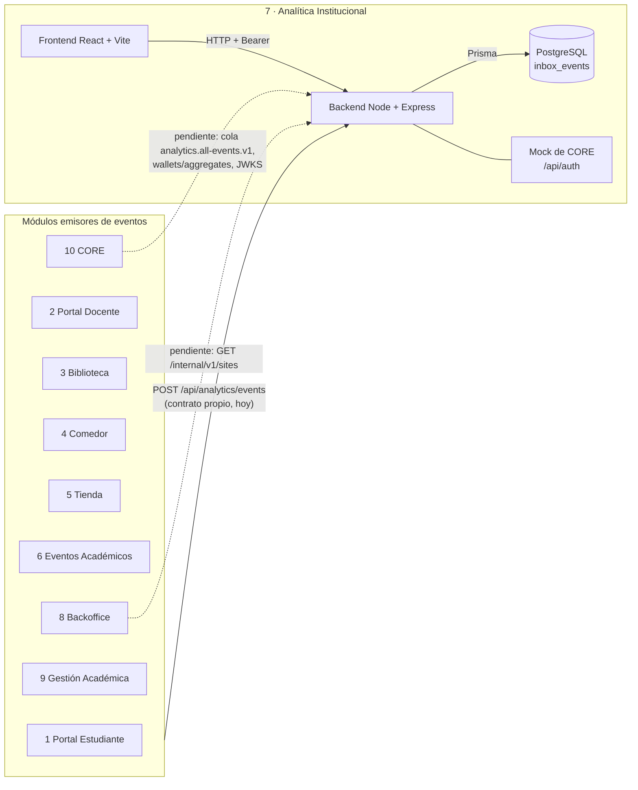

# Módulo 7 · Analítica Institucional (UADEnet)

Módulo de la plataforma UADEnet que recolecta los eventos de los otros módulos, los guarda en
PostgreSQL y los muestra en tableros para la dirección académica y la dirección financiera, con
una sección de estadísticas de eventos académicos. Todos los números salen de los eventos
ingeridos: **no hay datos mock** (sin eventos, los tableros muestran ceros y listas vacías).

Contexto del TP, flujos de datos de los demás equipos, decisiones de los POs y brechas de
integración: [CONTEXTO-UADENET.md](CONTEXTO-UADENET.md).

## Qué hace

| Sección | Rol que la ve | Filtros | Contenido |
|---|---|---|---|
| **Académica** | Dirección Académica | sede, cuatrimestre, facultad | Materias en curso, tasa de aprobación general, comisiones activas, estudiantes con cursada activa, aprobación por materia (3 cuatrimestres), tendencia por facultad, aprobación por docente |
| **Eventos académicos** | Dirección Académica | sede, mes | Eventos realizados, concurrencia, presentismo, ocupación de cupo, frecuencia por mes, presentismo por tipo |
| **Financiera** | Dirección Financiera | sede, mes | Saldo acumulado, ingresos, egresos, resultado, gastos administrativos (sueldos), productos más vendidos (unidades o facturación), facturación de comedores por sede |
| **Fuentes de datos** | Todos | — | Los 9 módulos emisores con su última ingesta y el tablero que alimentan |

Cada sección tiene su botón **Actualizar**. Los deltas comparan contra el período anterior del
catálogo; sin período anterior o sin datos en él, son neutros.

## Estado de la integración

| Con quién | Qué hace Analítica | Estado |
|---|---|---|
| **CORE (10)** | Login con mail `@uade.edu.ar` y validación del token (`Authorization: Bearer`) | **Mock** en `/api/auth` (`CoreAuthGateway`); es el único mock que queda |
| **Contrato de referencia** | CORE v1 (2026-08-05) más las novedades de CORE del 2026-11-04: envelope con `source`/`eventType.vN`/`data`, cola `analytics.all-events.v1`, `wallets/aggregates`, JWT por JWKS, gateway `/api/v1/analytics/*` | **Todavía no implementado**: nuestra ingesta usa el formato propio de `backend/EVENTOS.md`. Ver [qué habría que cambiar](CONTEXTO-UADENET.md#7-impacto-en-analítica-qué-tendríamos-que-cambiar) y la [matriz de brechas](CONTEXTO-UADENET.md#6-matriz-de-brechas) |
| **Los módulos emisores** | Mandan eventos a `POST /api/analytics/events` (público, validado por tipo, idempotente por `eventId`) | Endpoint real. No hay constancia de que algún módulo emita en el formato propio; el evento de Gestión Académica se absorbe con `warnings` (ver [Formatos tolerados](backend/EVENTOS.md#formatos-tolerados)) |
| **Backoffice (8)** | Catálogo de sedes: hoy sale de eventos propios `sede.definida`; toda sede viaja como `sedeId` | Backoffice **no emite** `sede.definida`: sus sedes se consultan por REST (`/internal/v1/sites`) |
| **Tableros** | Calculan sobre `inbox_events` (Postgres, vía Prisma) | Reales; sin datos mock |

## Arquitectura



Ambos paquetes siguen arquitectura por capas (`domain` → `application` → `infrastructure` /
`interfaces` / `presentation`). El detalle está en [CLAUDE.md](CLAUDE.md).

## Instalación y ejecución

Requiere **Node 20.12 o superior** y **Docker** (para PostgreSQL). Son dos paquetes
independientes, cada uno con su `node_modules`; hacen falta **dos terminales**.

```bash
# Terminal 1: backend en http://localhost:3000
cd backend
cp .env.example .env     # DATABASE_URL (obligatoria: sin ella el server no arranca)
npm install              # corre prisma generate
npm run db:up            # PostgreSQL 16 en Docker (localhost:5432, usuario/clave/base: analitica)
npm run db:migrate       # aplica las migraciones (tabla inbox_events)
npm run db:demo          # opcional: ~60 mil eventos de demo, determinístico y re-ejecutable
npm run dev

# Terminal 2: frontend en http://localhost:5173
cd frontend
npm install
npm run dev
```

- `npm run db:demo:clear` borra solo los eventos `demo-*`. `npm run db:seed` carga un seed mínimo
  de desarrollo (un evento representativo de cada tipo).
- El frontend apunta a `http://localhost:3000/api`; se cambia con `VITE_API_BASE_URL`.
- Producción: `npm run build` y `npm run start` en `backend/` (requiere `DATABASE_URL`; las
  migraciones se aplican con `npx prisma migrate deploy`).

### Cuentas de demo (mock de CORE)

| Mail | Rol | Ve |
|---|---|---|
| `direccion.academica@uade.edu.ar` | Dirección Académica | Académica y Eventos académicos |
| `direccion.financiera@uade.edu.ar` | Dirección Financiera | Financiera |
| `direccion.general@uade.edu.ar` | Ambos roles | Todas las secciones |

La contraseña de las tres es la constante `DEMO_PASSWORD` de
`backend/src/infrastructure/integrations/core-auth.gateway.mock.ts`.

## API

- **Contrato de eventos y esquema de cada payload (campos y tipos):** [backend/EVENTOS.md](backend/EVENTOS.md)
- **Contexto, flujos de los otros equipos y brechas con el contrato de CORE:** [CONTEXTO-UADENET.md](CONTEXTO-UADENET.md)
- **Colección de Postman** (login, tableros y un ejemplo de cada uno de los 26 eventos):
  [docs/postman/UADEnet-Analitica.postman_collection.json](docs/postman/UADEnet-Analitica.postman_collection.json).
  Importarla, completar la variable `demoPassword` y correr un Login: el token se guarda solo.

| Método | Ruta | Acceso |
|---|---|---|
| `POST` | `/api/auth/login` | Público (mock de CORE) |
| `GET` | `/api/auth/me` | Token |
| `GET` | `/api/analytics/filters` | Token |
| `GET` | `/api/analytics/dashboard/academic?sedeId=&cuatrimestre=&facultad=` | Token, rol académico |
| `GET` | `/api/analytics/events/stats?sedeId=&periodo=` | Token, rol académico |
| `GET` | `/api/analytics/dashboard/financial?sedeId=&periodo=` | Token, rol financiero |
| `GET` | `/api/analytics/sources` | Público |
| `GET` | `/api/analytics/roles` | Público |
| `GET` | `/api/analytics/events` | Público (lista lo ingerido, solo para desarrollo) |
| `POST` | `/api/analytics/events` | Público (lo llaman los otros módulos) |

`periodo` es un mes `AAAA-MM`. La documentación de payloads y la colección de Postman se
regeneran desde `backend/src/domain/entities/event-schemas.ts` con `npm run docs` (en `backend/`).

## Más documentación

- [CONTEXTO-UADENET.md](CONTEXTO-UADENET.md): consigna del TP, contrato de CORE vigente, decisiones de los POs, flujos de datos y brechas, diseño y pendientes.
- [CLAUDE.md](CLAUDE.md): guía de arquitectura y convenciones para trabajar en el repo.
