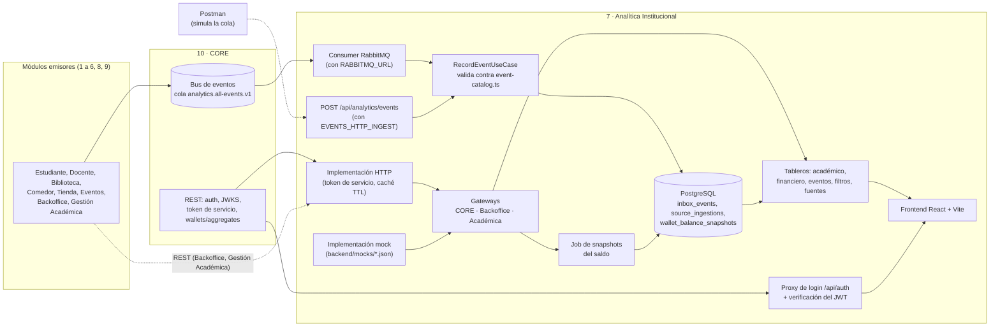

# Módulo 7 · Analítica Institucional (UADEnet)

Módulo de la plataforma UADEnet que recolecta los eventos de los otros módulos (por la cola de
CORE), consulta en vivo a CORE, Backoffice y Gestión Académica, y muestra todo en tableros para la
dirección académica y la dirección financiera, con una sección de estadísticas de eventos
académicos. Los eventos se guardan en PostgreSQL; el resto sale por REST.

Mientras los otros grupos no estén listos, cada integración se puede **simular** con un flag: los
eventos con Postman y las respuestas REST con archivos `.json` editables a mano (ver
[Modos mock y real](#modos-mock-y-real)).

## Qué hace

| Sección | Rol que la ve | Filtros | Contenido |
|---|---|---|---|
| **Académica** | Dirección Académica | sede, cuatrimestre, facultad | Materias en curso, tasa de aprobación general, comisiones activas, estudiantes con cursada activa, aprobación por materia (3 cuatrimestres), tendencia por facultad, aprobación por docente |
| **Eventos académicos** | Dirección Académica | sede, mes | Eventos realizados, concurrencia, presentismo, ocupación de cupo, frecuencia por mes, presentismo por tipo |
| **Financiera** | Dirección Financiera | sede, mes | Saldo acumulado, ingresos, egresos, resultado, gastos administrativos (sueldos y becas), productos más vendidos (unidades o facturación), facturación de comedores por sede |
| **Fuentes de datos** | Todos | — | Los 9 módulos emisores con su última ingesta y el tablero que alimentan |

Cada sección tiene su botón **Actualizar**. Los deltas comparan contra el período anterior del
catálogo; sin período anterior o sin datos en él, son neutros. Cuando una fuente externa no responde, el
bloque afectado se ve vacío (`—`) con un aviso arriba del tablero: nunca se muestran números inventados.
El saldo, los ingresos y los egresos de CORE no se pueden abrir por sede: con una sede elegida se muestran
los valores institucionales y el tablero lo aclara.

Los filtros viajan como `?sedeId=` (el `siteId` UUID de Backoffice), `?cuatrimestre=2026-2C`,
`?facultad=` y `?periodo=AAAA-MM`.

## Arquitectura



Líneas punteadas: caminos que dependen de flags o de que el otro grupo habilite la ruta. Ambos paquetes
siguen arquitectura por capas (`domain` → `application` → `infrastructure` / `interfaces` /
`presentation`); el detalle está en [CLAUDE.md](CLAUDE.md).

## Modos mock y real

Cada servicio externo tiene su flag. Con el flag en `true` (valor por defecto) el gateway lee
`backend/mocks/<servicio>/*.json` en cada llamada; con `false` llama al servicio real. Se pueden mezclar
(por ejemplo, CORE real y Backoffice mock).

| Variable | Default | Efecto |
|---|---|---|
| `CORE_MOCK` | `true` | `true`: login, JWT (firmado con un par RSA local en `backend/.mock-keys/`) y `wallets/aggregates` de `mocks/core/`. `false`: CORE real (exige `CORE_BASE_URL`, `CORE_CLIENT_SECRET` y `CORE_JWT_ISSUER`) |
| `BACKOFFICE_MOCK` | `true` | `true`: sedes y fichas de usuario de `mocks/backoffice/`. `false`: exige `BACKOFFICE_BASE_URL` |
| `ACADEMIC_MOCK` | `true` | `true`: períodos, sedes, catálogo y cursos de `mocks/academic/`. `false`: exige `ACADEMIC_BASE_URL` |
| `EVENTS_HTTP_INGEST` | `false` (`true` en `.env.example`) | `true` monta `POST` y `GET /api/analytics/events`, que simulan la cola. Apagado, ambas dan `404` |
| `RABBITMQ_URL` | sin definir | Si existe, arranca el consumer de la cola `analytics.all-events.v1`; si no, no hay consumer |
| `INBOX_STORE_UNKNOWN` | `false` | Guarda también los `eventType` fuera del catálogo |
| `WALLET_SNAPSHOT_ENABLED` | `true` | Job que fotografía el saldo de CORE cada `WALLET_SNAPSHOT_INTERVAL_MIN` minutos |
| `WALLET_SNAPSHOT_BACKFILL_MONTHS` | `0` (`6` en `.env.example`) | Meses anteriores a reconstruir al arrancar. Sólo con mocks, o cuando CORE confirme que `to` fija la fecha del saldo |
| `DATABASE_URL` | obligatoria | Postgres. Sin ella el servidor no arranca |

Todas las variables, sus defaults y su efecto están en [`docs/INTEGRACION.md`](docs/INTEGRACION.md#2-variables-de-entorno-y-flags)
(sección 2) y en `backend/.env.example`. `GET /health/ready` informa el modo de cada servicio
(`core`, `backoffice`, `academic`: `mock` o `http`), la base y el consumer.

## Cómo levantarlo desde cero

Requiere **Node 20.12 o superior** y **Docker** (para PostgreSQL). Son dos paquetes independientes, cada
uno con su `node_modules`; hacen falta **dos terminales**.

```bash
# Terminal 1: backend en http://localhost:3000
cd backend
cp .env.example .env     # modo demo: todo mock y POST de eventos activo
npm install              # corre prisma generate
npm run db:up            # PostgreSQL 16 en Docker (localhost:5432, usuario/clave/base: analitica)
npm run db:migrate       # aplica las migraciones (inbox_events, source_ingestions, wallet_balance_snapshots)
npm run db:demo          # ~34,6 mil eventos de demo en formato v1 (determinístico y re-ejecutable)
npm run mocks:generate   # opcional: sólo si borraste backend/mocks; no pisa tus ediciones sin --force
npm run dev

# Terminal 2: frontend en http://localhost:5173
cd frontend
cp .env.example .env     # VITE_API_BASE_URL (por defecto http://localhost:3000/api)
npm install
npm run dev
```

- Los mocks ya están versionados en `backend/mocks/`; `mocks:generate` sólo los recrea. Los eventos del demo y
  los mocks salen de los mismos ids (`backend/demo/ids.ts`), así que se ven coherentes en los tres tableros.
  `npm run mocks:check` valida el shape de cada archivo y esa coherencia.
- `npm run db:demo` también carga los snapshots de saldo de los meses de los mocks de CORE.
  `npm run db:demo:clear` borra los eventos del demo y esos snapshots, sin tocar los eventos que llegaron por
  Postman o por la cola.
- Producción: `npm run build` y `npm run start` en `backend/` (requiere `DATABASE_URL`; las migraciones se
  aplican con `npx prisma migrate deploy`) y `npm run build` en `frontend/`.

### Usuarios demo

Con `CORE_MOCK=true` el login `@uade.edu.ar` sale de `backend/mocks/core/users.json`. La contraseña de todos
es `uadenet2026`: es de demo y existe sólo en el mock, **no** es ninguna credencial de CORE.

| Mail | Rol de CORE | Ve |
|---|---|---|
| `direccion.academica@uade.edu.ar` | `ACADEMIC_ADMIN` | Académica y Eventos académicos |
| `direccion.financiera@uade.edu.ar` | `FINANCE_ADMIN` | Financiera |
| `direccion.general@uade.edu.ar` | `ADMIN` | Todas las secciones |
| `alumno.demo@uade.edu.ar` | `STUDENT` | Nada: `403 ANALYTICS_FORBIDDEN` |
| `suspendido.demo@uade.edu.ar` | `ACADEMIC_ADMIN` suspendido | Nada: `403 AUTH_IDENTITY_SUSPENDED` |

Con CORE real se usan las identidades de CORE: `ACADEMIC_ADMIN` ve la sección académica, `FINANCE_ADMIN` la
financiera y `ADMIN` ambas.

## Simular eventos con Postman

La colección [`docs/postman/UADEnet-Analitica.postman_collection.json`](docs/postman/UADEnet-Analitica.postman_collection.json)
se genera con `npm run docs` (en `backend/`) desde el catálogo de eventos. Con `EVENTS_HTTP_INGEST=true`:

1. Importarla y correr un login de la carpeta **Auth**: el token se guarda solo.
2. En **Cola (simulación)** hay una request por cada `eventType` que se guarda, los que se descartan
   (`202`), casos borde (corrección de un resultado, duplicado) y errores de contrato (`400`). Cada envío
   lleva `eventId` y `occurredAt` nuevos y datos coherentes con el demo.
3. En **Tableros** se vuelve a pedir el tablero para ver el efecto.

El formato de los eventos, las respuestas y qué se guarda o se descarta están en
[`backend/EVENTOS.md`](backend/EVENTOS.md).

## Editar los mocks a mano

Cada archivo de `backend/mocks/` es el body JSON de la respuesta del módulo real, se relee en cada request
(sin reiniciar) y puede simular una falla con `__mockStatus`. Las reglas, la lista de archivos, qué hay en el
demo y cómo regenerar o validar están en [`backend/mocks/README.md`](backend/mocks/README.md).

## Pasar a modo real: checklist

Todo esto depende de que cada grupo haya habilitado su parte (preguntas abiertas en
[`docs/INTEGRACION.md`](docs/INTEGRACION.md#9-preguntas-abiertas)):

- [ ] **Cola:** CORE crea `analytics.all-events.v1` y entrega una credencial de **sólo lectura**: definir
  `RABBITMQ_URL` (y `RABBITMQ_QUEUE` si cambia). Poner `EVENTS_HTTP_INGEST=false`.
- [ ] **CORE:** `CORE_MOCK=false` con `CORE_BASE_URL`, `CORE_CLIENT_ID`, `CORE_CLIENT_SECRET` (sólo en el entorno,
  nunca en Git), `CORE_JWT_ISSUER` (verificar contra un JWT real) y `CORE_JWT_AUDIENCE`. El cliente
  `analytics-service` necesita `wallet:read:aggregates` (y `events:read` para `npm run backfill:core`).
- [ ] **Backoffice:** `BACKOFFICE_MOCK=false` y `BACKOFFICE_BASE_URL`; `analytics-service` necesita `backoffice:read`.
- [ ] **Gestión Académica:** `ACADEMIC_MOCK=false` y `ACADEMIC_BASE_URL`; G9 tiene que exponer las rutas
  `/internal/v1` y autorizar a `analytics-service`.
- [ ] **Sesión:** si el SPA y el backend quedan en sitios distintos, `AUTH_COOKIE_SAMESITE=none` (exige HTTPS);
  ajustar `CORS_ORIGINS` al origen del frontend.
- [ ] **Base:** `DATABASE_URL` real y `npx prisma migrate deploy`. No cargar el demo (`db:demo`) en esa base.
- [ ] **Snapshots:** `WALLET_SNAPSHOT_BACKFILL_MONTHS=0` hasta que CORE aclare qué saldo devuelve `aggregates`
  con una fecha pasada.
- [ ] Verificar `GET /health/ready`: `core`, `backoffice` y `academic` en `http`, y `broker` en `up`.

## API

| Método | Ruta | Acceso |
|---|---|---|
| `POST` | `/api/auth/login` | Público (proxy de CORE o su mock) |
| `POST` | `/api/auth/refresh` | Cookie de refresh |
| `POST` | `/api/auth/logout` | Cookie de refresh |
| `GET` | `/api/auth/me` | Token |
| `GET` | `/api/analytics/filters` | Token |
| `GET` | `/api/analytics/dashboard/academic?sedeId=&cuatrimestre=&facultad=` | Token, rol académico |
| `GET` | `/api/analytics/events/stats?sedeId=&periodo=` | Token, rol académico |
| `GET` | `/api/analytics/dashboard/financial?sedeId=&periodo=` | Token, rol financiero |
| `GET` | `/api/analytics/sources` | Público |
| `GET` | `/api/analytics/roles` | Público |
| `GET` | `/api/analytics/events` | Público, sólo con `EVENTS_HTTP_INGEST=true` (depuración) |
| `POST` | `/api/analytics/events` | Público, sólo con `EVENTS_HTTP_INGEST=true` (simula la cola) |
| `GET` | `/health/live`, `/health/ready` | Público |

Las rutas de `/api/analytics` también responden bajo `/api/v1` (el gateway de CORE reescribe
`/api/v1/analytics/*` a `/api/v1/*`). Los errores son `application/problem+json`.

## Más documentación

- [`docs/INTEGRACION.md`](docs/INTEGRACION.md): especificación técnica de la integración (flags, catálogo de eventos, endpoints que consumimos, mocks, mapeo métrica a fuente, preguntas abiertas) y desvíos de lo implementado.
- [`CONTEXTO-UADENET.md`](CONTEXTO-UADENET.md): consigna del TP, contrato de CORE vigente, decisiones de los POs, flujos de los otros equipos, estado de implementación y pendientes.
- [`backend/EVENTOS.md`](backend/EVENTOS.md): contrato de ingesta de eventos y tabla de tipos.
- [`backend/mocks/README.md`](backend/mocks/README.md): cómo editar y regenerar los mocks.
- [`CLAUDE.md`](CLAUDE.md): guía de arquitectura y convenciones para trabajar en el repo.
