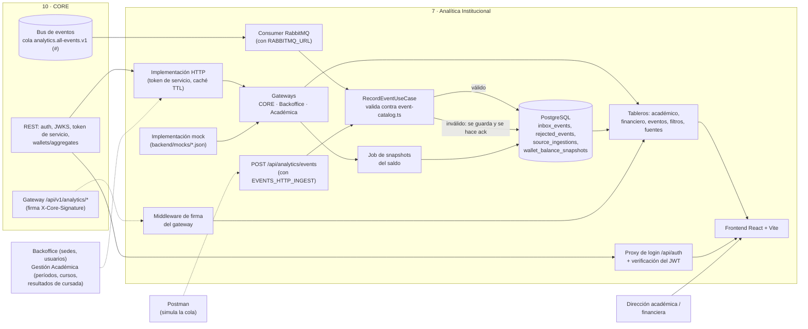
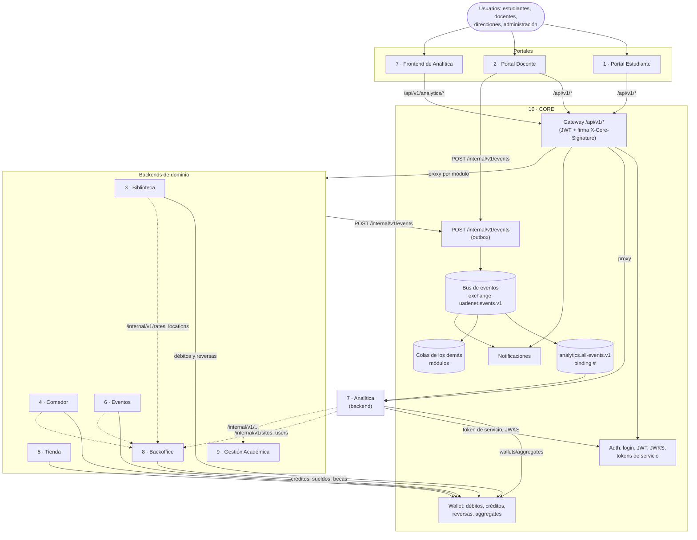

# Módulo 7 · Analítica Institucional (UADEnet)

Módulo de la plataforma UADEnet que recolecta los eventos de los otros módulos (por la cola de
CORE), consulta en vivo a CORE, Backoffice y Gestión Académica, y muestra todo en tableros para la
dirección académica y la dirección financiera, con una sección de estadísticas de eventos
académicos. Los eventos se guardan en PostgreSQL; el resto sale por REST.

Cada integración se puede **simular** con un flag (eventos con Postman, respuestas REST con archivos
`.json` editables) o usar en **modo real**. En producción: frontend en Vercel
(`https://modulo7-umber.vercel.app`), backend en Render y base en Neon.

**Contenido:** [Qué hace](#qué-hace) · [Arquitectura del módulo](#arquitectura-del-módulo) ·
[Arquitectura general de UADEnet](#arquitectura-general-del-sistema-uadenet) ·
[Instalación y ejecución local](#instalación-y-ejecución-local) · [Modo real y producción](#modo-real-y-producción) ·
[Herramientas](#herramientas) · [Estado de integración](#estado-de-integración-por-módulo) · [API](#api)

## Qué hace

| Sección | Rol que la ve | Filtros | Contenido |
|---|---|---|---|
| **Académica** | Dirección Académica | sede, cuatrimestre, facultad | Materias en curso, tasa de aprobación general, comisiones activas, estudiantes con cursada activa, aprobación por materia (3 cuatrimestres), tendencia por facultad, aprobación por docente |
| **Eventos académicos** | Dirección Académica | sede, mes | Eventos realizados, concurrencia, presentismo, ocupación de cupo, frecuencia por mes, presentismo por tipo |
| **Financiera** | Dirección Financiera | sede, mes | Saldo acumulado, ingresos, egresos, resultado, gastos administrativos (sueldos y becas), productos más vendidos (unidades o facturación), facturación de comedores por sede |
| **Fuentes de datos** | Todos | — | Los 9 módulos emisores con su última ingesta y el tablero que alimentan |

Cada sección tiene su botón **Actualizar**. Los deltas comparan contra el período anterior del
catálogo; sin período anterior o sin datos en él, son neutros. Cuando una fuente externa no responde, el
bloque afectado se ve vacío (`—`) con un aviso arriba del tablero: nunca se muestran números inventados.
El saldo, los ingresos y los egresos de CORE no se pueden abrir por sede: con una sede elegida se muestran
los valores institucionales y el tablero lo aclara.

Los filtros viajan como `?sedeId=` (el `siteId` UUID de Backoffice), `?cuatrimestre=2026-2C`,
`?facultad=` y `?periodo=AAAA-MM`.

## Arquitectura del módulo



Líneas punteadas: caminos que dependen de flags o de que el otro grupo habilite la ruta. El consumer nunca
hace `nack`: un mensaje inválido se guarda en `rejected_events` (motivo y cuerpo original) y se hace `ack`;
un error transitorio se reintenta y, si persiste, se reconecta para recibir de nuevo los mensajes. Ambos
paquetes siguen arquitectura por capas (`domain` → `application` → `infrastructure` / `interfaces` /
`presentation`); el detalle está en [CLAUDE.md](CLAUDE.md).

## Arquitectura general del sistema UADEnet

UADEnet son 10 módulos independientes. **CORE** (módulo 10) autentica, expone el gateway de los portales,
administra la wallet y las notificaciones, y opera el bus de eventos. Los portales hablan sólo con el gateway;
los backends se publican eventos por CORE y se consultan entre sí por REST interno con token de servicio.



Línea continua: integración operativa; línea punteada: lectura REST interna entre backends o integración
que depende de que el otro grupo la habilite. Para Analítica, CORE y Backoffice están integrados; Gestión
Académica todavía no nos habilitó sus rutas (ver [estado de integración](#estado-de-integración-por-módulo)).
El detalle de eventos y endpoints de cada módulo está en
[`docs/CORE-contrato-integracion-v1.md`](docs/CORE-contrato-integracion-v1.md) y en
[`docs/INTEGRACION.md`](docs/INTEGRACION.md).

## Instalación y ejecución local

Modo mock, todo en tu máquina y sin depender de los otros grupos. Requiere **Node 20.12 o superior** (en
producción se usa Node 22) y **Docker** (para PostgreSQL). Son dos paquetes independientes, cada uno con su
`node_modules`; hacen falta **dos terminales**, siempre parado en `backend/` o `frontend/` (la raíz no tiene scripts).

```bash
# Terminal 1: backend en http://localhost:3000
cd backend
cp .env.example .env     # modo demo: todo mock y POST de eventos activo
npm install              # corre prisma generate
npm run db:up            # PostgreSQL 16 en Docker (localhost:5432, usuario/clave/base: analitica)
npm run db:migrate       # aplica las migraciones
npm run db:demo          # ~35 mil eventos de demo en formato v1 + snapshots de saldo (re-ejecutable)
npm run dev

# Terminal 2: frontend en http://localhost:5173
cd frontend
cp .env.example .env     # VITE_API_BASE_URL (por defecto http://localhost:3000/api)
npm install
npm run dev
```

Entrar a `http://localhost:5173` con un usuario demo (abajo). `GET http://localhost:3000/health/ready` informa
el modo de cada servicio (`mock` o `http`), la base y el consumer.

- Los mocks ya están versionados en `backend/mocks/`; `npm run mocks:generate` sólo los recrea. Los eventos del
  demo y los mocks salen de los mismos ids (`backend/demo/ids.ts`), así que se ven coherentes en los tres tableros.
- `npm run db:demo:clear` borra los eventos del demo y sus snapshots, sin tocar los que llegaron por Postman o la cola.
- `npm run build` en cada paquete compila (`tsc`); el frontend además valida tipos con `tsc -b`. No hay tests automatizados.

### Usuarios

Con `CORE_MOCK=true` el login `@uade.edu.ar` sale de `backend/mocks/core/users.json`. La contraseña de todos
es `uadenet2026`: es de demo y existe sólo en el mock, **no** es ninguna credencial de CORE.

| Mail | Rol de CORE | Ve |
|---|---|---|
| `direccion.academica@uade.edu.ar` | `ACADEMIC_ADMIN` | Académica y Eventos académicos |
| `direccion.financiera@uade.edu.ar` | `FINANCE_ADMIN` | Financiera |
| `direccion.general@uade.edu.ar` | `ADMIN` | Todas las secciones |
| `alumno.demo@uade.edu.ar` | `STUDENT` | Nada: `403 ANALYTICS_FORBIDDEN` |
| `suspendido.demo@uade.edu.ar` | `ACADEMIC_ADMIN` suspendido | Nada: `403 AUTH_IDENTITY_SUSPENDED` |

Con CORE real se usan las identidades de CORE: `ACADEMIC_ADMIN` ve la sección académica, `FINANCE_ADMIN` la
financiera y `ADMIN` ambas.

## Modo real y producción

Cada servicio externo tiene su flag. Con `*_MOCK=true` (valor por defecto) el gateway lee
`backend/mocks/<servicio>/*.json` en cada llamada; con `false` llama al servicio real. Se pueden mezclar
(por ejemplo CORE real y Gestión Académica mock). **Los secretos van sólo en el entorno del deploy, nunca en Git.**

| Variable | Default | Qué cambia |
|---|---|---|
| `DATABASE_URL` | obligatoria | Postgres (en producción, Neon). Sin ella el servidor no arranca |
| `CORE_MOCK` | `true` | `false`: login, JWT y `wallets/aggregates` contra CORE real (`CORE_BASE_URL`, `CORE_CLIENT_ID`, `CORE_CLIENT_SECRET`, `CORE_JWT_ISSUER`, `CORE_JWT_AUDIENCE`). Los usuarios pasan a ser las cuentas de CORE |
| `BACKOFFICE_MOCK` | `true` | `false`: sedes y fichas de usuario de Backoffice real (`BACKOFFICE_BASE_URL`) |
| `ACADEMIC_MOCK` | `true` | `false`: períodos, cursos y catálogo de Gestión Académica real (`ACADEMIC_BASE_URL`). **Hoy sigue en `true` en producción** hasta que G9 nos habilite |
| `RABBITMQ_URL` | sin definir | Arranca el consumer de `analytics.all-events.v1` con el usuario de sólo lectura de CORE. Debe estar definida en **un solo** backend |
| `EVENTS_HTTP_INGEST` | `false` | `true` monta `POST/GET /api/analytics/events` (simula la cola). En producción, `false` |
| `CORE_GATEWAY_SECRET` | vacío | Con valor, `/api/v1/*` exige `X-Core-Signature` del gateway de CORE; vacío no valida y avisa al arrancar |
| `CORS_ORIGINS` | `http://localhost:5173` | Origen(es) del frontend, separados por coma (en producción, la URL de Vercel) |
| `AUTH_COOKIE_SAMESITE` | `lax` | `none` cuando frontend y backend están en dominios distintos (exige HTTPS) |
| `WALLET_SNAPSHOT_ENABLED` / `WALLET_SNAPSHOT_BACKFILL_MONTHS` | `true` / `0` | Job que fotografía el saldo de CORE y meses anteriores a reconstruir al arrancar |
| `INBOX_STORE_UNKNOWN` | `false` | Guarda también los `eventType` fuera del catálogo |

Todas las variables (también caché, timeouts y tablero) están en
[`docs/INTEGRACION.md`](docs/INTEGRACION.md#2-variables-de-entorno-y-flags) y en `backend/.env.example`, que
trae al final el bloque de producción comentado con las URLs públicas de CORE, Backoffice y Gestión Académica.

### Deploy

1. **Base (Neon):** crear un proyecto PostgreSQL y copiar su cadena de conexión a `DATABASE_URL` del backend.
   No cargar el demo (`db:demo`) en esa base.
2. **Backend (Render):** Web Service con *Root Directory* `backend`, **Node 22**.
   - Build: `npm install && npm run build && npx prisma migrate deploy`
   - Start: `npm run start`
   - Variables: `DATABASE_URL`, `CORE_MOCK=false`, `BACKOFFICE_MOCK=false`, `ACADEMIC_MOCK=true` (hasta que G9
     habilite), `CORE_BASE_URL`, `CORE_JWT_ISSUER`, `CORE_CLIENT_SECRET`, `CORE_GATEWAY_SECRET`,
     `BACKOFFICE_BASE_URL`, `RABBITMQ_URL`, `EVENTS_HTTP_INGEST=false`, `AUTH_COOKIE_SAMESITE=none`,
     `CORS_ORIGINS=https://modulo7-umber.vercel.app`.
   - Mantener **una sola instancia con `RABBITMQ_URL`** (dos consumers sobre la misma cola se reparten los mensajes).
   - Verificar `GET /health/ready`: `core` y `backoffice` en `http`, `broker` en `up`.
3. **Frontend (Vercel):** variable `VITE_API_BASE_URL=https://<backend-en-render>/api` y deploy con
   `vercel --prod` desde `frontend/` (pasos en [`frontend/DEPLOY.md`](frontend/DEPLOY.md)).
4. **Carga histórica opcional** (con `CORE_MOCK=false`), parado en `backend/`: `npm run backfill:core` y
   `npm run backfill:results`.

## Herramientas

- **Postman:** la colección [`docs/postman/UADEnet-Analitica.postman_collection.json`](docs/postman/UADEnet-Analitica.postman_collection.json)
  se genera desde el catálogo de eventos (`npm run docs` en `backend/`). Con `EVENTS_HTTP_INGEST=true`: correr un
  login de la carpeta **Auth** (el token se guarda solo), enviar eventos desde **Cola (simulación)** (uno por cada
  `eventType` que se guarda, los que se descartan, casos borde y errores de contrato) y volver a pedir el tablero
  en **Tableros**. Formato y respuestas (`201`, `200`, `202`, `400`) en [`backend/EVENTOS.md`](backend/EVENTOS.md).
- **Mocks editables:** cada archivo de `backend/mocks/` es el body JSON de la respuesta del módulo real, se relee en
  cada request (sin reiniciar) y puede simular una falla con `__mockStatus`. Reglas en
  [`backend/mocks/README.md`](backend/mocks/README.md).
- **Scripts** (en `backend/`): `mocks:generate` y `mocks:check` (regenerar y validar mocks), `docs` / `docs:payloads` /
  `docs:postman` (regenerar `EVENTOS.md` y Postman), `db:demo` / `db:demo:clear`, `backfill:core` (histórico de eventos
  de CORE) y `backfill:results` (histórico de resultados de cursada de Gestión Académica); ambos exigen el servicio real.

## Estado de integración por módulo

| Módulo | Qué usa Analítica | Estado |
|---|---|---|
| 10 · CORE | Login/JWT/JWKS, token de servicio, `wallets/aggregates`, cola `analytics.all-events.v1`, gateway con firma | Integrado en modo real |
| 8 · Backoffice | `/internal/v1/sites` y `/users/{id}`; eventos de sedes y usuarios | Integrado en modo real |
| 9 · Gestión Académica | Períodos, cursos, catálogo, `academic.course-result.published.v1` e histórico de resultados | Pendiente de G9: habilitar a `analytics-service`; en producción `ACADEMIC_MOCK=true` |
| 3 · Biblioteca, 4 · Comedor, 5 · Tienda, 6 · Eventos | Eventos por la cola (multas, compras, reservas, inscripciones, asistencia) | Consumimos lo que publiquen; el contrato sigue en validación con cada grupo |
| 1 · Estudiante, 2 · Docente | Eventos del Portal Docente (resultados y asistencia) | Pendiente de que publiquen; ver preguntas abiertas en `docs/INTEGRACION.md` |

## API

| Método | Ruta | Acceso |
|---|---|---|
| `POST` | `/api/auth/login` | Público (proxy de CORE o su mock) |
| `POST` | `/api/auth/refresh` | Cookie de refresh |
| `POST` | `/api/auth/logout` | Cookie de refresh |
| `GET` | `/api/auth/me` | Token |
| `GET` | `/api/analytics/filters` | Token |
| `GET` | `/api/analytics/dashboard/academic?sedeId=&cuatrimestre=&facultad=` | Token, rol académico |
| `GET` | `/api/analytics/events/stats?sedeId=&periodo=` | Token, rol académico |
| `GET` | `/api/analytics/dashboard/financial?sedeId=&periodo=` | Token, rol financiero |
| `GET` | `/api/analytics/sources` | Público |
| `GET` | `/api/analytics/roles` | Público |
| `GET` | `/api/analytics/events` | Público, sólo con `EVENTS_HTTP_INGEST=true` (depuración) |
| `POST` | `/api/analytics/events` | Público, sólo con `EVENTS_HTTP_INGEST=true` (simula la cola) |
| `GET` | `/health/live`, `/health/ready` | Público |

Las rutas de `/api/analytics` también responden bajo `/api/v1` (el gateway de CORE reescribe
`/api/v1/analytics/*` a `/api/v1/*`). Los errores son `application/problem+json`.

## Más documentación

- [`docs/INTEGRACION.md`](docs/INTEGRACION.md): especificación técnica de la integración (flags, catálogo de eventos, endpoints que consumimos, mocks, mapeo métrica a fuente, preguntas abiertas) y desvíos de lo implementado.
- [`docs/CORE-contrato-integracion-v1.md`](docs/CORE-contrato-integracion-v1.md): contrato de CORE (auth, gateway, wallet, bus y catálogo de eventos).
- [`backend/EVENTOS.md`](backend/EVENTOS.md): contrato de ingesta de eventos y tabla de tipos.
- [`backend/mocks/README.md`](backend/mocks/README.md): cómo editar y regenerar los mocks.
- [`frontend/DEPLOY.md`](frontend/DEPLOY.md): deploy del frontend a Vercel.
- [`CONTEXTO-UADENET.md`](CONTEXTO-UADENET.md): consigna del TP, decisiones de los POs, flujos de los otros equipos y pendientes.
- [`CLAUDE.md`](CLAUDE.md): guía de arquitectura y convenciones para trabajar en el repo.
