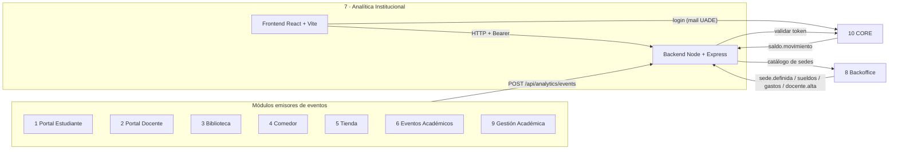

# Módulo 7 · Analítica Institucional (UADEnet)

Módulo de la plataforma UADEnet que recolecta los eventos de los otros 9 módulos y los
muestra en tableros para la dirección académica y la dirección financiera, con una sección
de estadísticas de eventos académicos.

- **Dirección Académica:** materias en curso, estudiantes con cursada activa, tasa de
  aprobación por materia (cuatrimestres anteriores) y por docente.
- **Dirección Financiera:** balance de saldo, gastos administrativos (con salarios),
  productos más vendidos de la tienda y facturación de los comedores por sede.
- **Estadísticas de eventos:** frecuencia, concurrencia, presentismo y ocupación de cupo.
- **Fuentes de datos:** los 9 módulos emisores con su estado, última ingesta y el tablero que alimentan (la ven todos los usuarios).

## Estado de la integración

| Con quién | Qué hace Analítica | Estado |
|---|---|---|
| **CORE (10)** | Login con mail de la universidad y validación del token (`Authorization: Bearer`) | **Mock** en `/api/auth` (`CoreAuthGateway`) |
| **Backoffice (8)** | Catálogo de sedes (`sede.definida`); toda sede viaja como `sedeId` | **Mock** (`BackofficeSitesGateway`) |
| **Los 9 módulos emisores** | Reciben su contrato en `POST /api/analytics/events` | Endpoint real, validado por tipo de evento; absorbe el formato real de Gestión Académica (`tipo`, `ocurridoEn`, campos sueltos) con `warnings`, ver [Formatos tolerados](backend/EVENTOS.md#formatos-tolerados) |
| Tableros | Calculan sobre un dataset mock | Todavía **no** leen los eventos ingeridos (falta base de datos) |

Cuando exista el módulo real, se reemplaza la clase de `backend/src/infrastructure/integrations/`
y el resto del backend no cambia.

## Arquitectura



Ambos paquetes siguen arquitectura por capas (`domain` → `application` → `infrastructure` /
`interfaces` / `presentation`). El detalle está en [CLAUDE.md](CLAUDE.md).

## Instalación y ejecución

Requiere Node 20 o superior. Son dos paquetes independientes, cada uno con su
`node_modules`; hacen falta **dos terminales**.

```bash
# Terminal 1: backend en http://localhost:3000
cd backend
npm install
npm run dev

# Terminal 2: frontend en http://localhost:5173
cd frontend
npm install
npm run dev
```

El frontend apunta a `http://localhost:3000/api`; se cambia con `VITE_API_BASE_URL`.

### Cuentas de demo (mock de CORE)

| Mail | Rol | Ve |
|---|---|---|
| `direccion.academica@uade.edu.ar` | Dirección Académica | Tablero académico |
| `direccion.financiera@uade.edu.ar` | Dirección Financiera | Tablero financiero y estadísticas de eventos |
| `direccion.general@uade.edu.ar` | Ambos roles | Los dos tableros (un usuario puede tener varios roles) |

La contraseña de las tres es la constante `uadenet2026` de
`backend/src/infrastructure/integrations/core-auth.gateway.mock.ts`.

## API

- **Contrato de eventos y esquema de cada payload (campos y tipos):** [backend/EVENTOS.md](backend/EVENTOS.md)
- **Qué datos le pedimos a cada módulo, con ejemplos:** [DATOS-POR-MODULO.md](DATOS-POR-MODULO.md)
- **Colección de Postman** (login, tableros y un ejemplo de cada uno de los 26 eventos):
  [docs/postman/UADEnet-Analitica.postman_collection.json](docs/postman/UADEnet-Analitica.postman_collection.json).
  Importarla, completar la variable `demoPassword` y correr un Login: el token se guarda solo.

| Método | Ruta | Acceso |
|---|---|---|
| `POST` | `/api/auth/login` | Público (mock de CORE) |
| `GET` | `/api/auth/me` | Token |
| `GET` | `/api/analytics/filters` | Token |
| `GET` | `/api/analytics/dashboard/academic?sedeId=&cuatrimestre=` | Token, rol académico |
| `GET` | `/api/analytics/dashboard/financial?sedeId=&periodo=` | Token, rol financiero |
| `GET` | `/api/analytics/events/stats?sedeId=&periodo=` | Token, rol financiero |
| `GET` | `/api/analytics/sources` | Público |
| `POST` | `/api/analytics/events` | Público (lo llaman los otros módulos) |

La documentación de payloads y la colección de Postman se regeneran desde
`backend/src/domain/entities/event-schemas.ts` con `npm run docs` (en `backend/`).

## Más documentación

- [ANALISIS-DISENO.md](ANALISIS-DISENO.md): auditoría del diseño contra la implementación.
- [TPOUADENET.md](TPOUADENET.md) y [backend/INTEGRACION-ACADEMICA.md](backend/INTEGRACION-ACADEMICA.md): contexto del TPO e integración con Gestión Académica.
