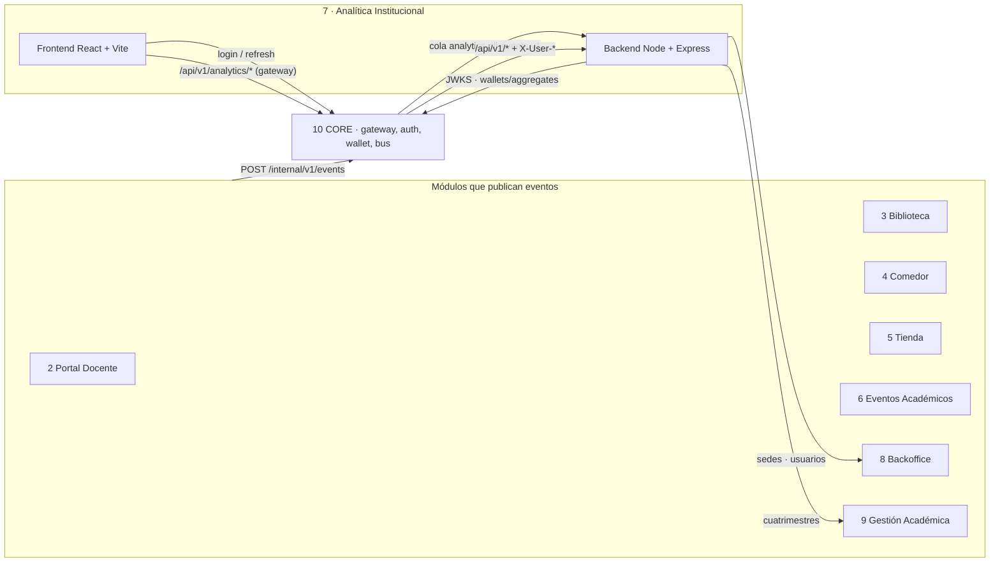

# Módulo 7 · Analítica Institucional (UADEnet)

Módulo de la plataforma UADEnet que recolecta los eventos de los otros 9 módulos y los
muestra en tableros para la dirección académica y la dirección financiera, con una sección
de estadísticas de eventos académicos.

- **Dirección Académica:** materias en curso, estudiantes con cursada activa, tasa de
  aprobación por materia (cuatrimestres anteriores) y por docente.
- **Dirección Financiera:** balance de saldo, gastos administrativos (con salarios),
  productos más vendidos de la tienda y facturación de los comedores por sede.
- **Estadísticas de eventos:** frecuencia, concurrencia, presentismo y ocupación de cupo.
- **Fuentes de datos:** los 9 módulos emisores con su estado, última ingesta y el tablero que alimentan (la ven todos los usuarios).

## Estado de la integración

El módulo sigue el contrato de integración **CORE v1** (2026-08-05). El flujo de datos completo
(qué consumimos, por qué canal y con qué estructura) está en
[docs/Flujo_de_Datos_Modulo_7_Analitica.xlsx](docs/Flujo_de_Datos_Modulo_7_Analitica.xlsx).

| Con quién | Qué hace Analítica | Estado |
|---|---|---|
| **CORE (10) · Auth** | El portal hace login contra CORE. El backend valida el JWT RS256 localmente con el JWKS y autoriza por permiso `analytics:*` | **Mock** de CORE servido por el mismo backend (`/api/v1/auth/*`, `/.well-known/jwks.json`) |
| **CORE (10) · Event Bus** | Consume todo el bus por la cola `analytics.all-events.v1` (binding `#`), con deduplicación por `eventId` | **Simulado** con `POST /api/v1/dev/events`; inbox en memoria |
| **CORE (10) · Service Auth** | Token de servicio de `analytics-service` (`POST /internal/v1/service-auth/token`), cacheado hasta que vence | **Mock** por defecto. Con `CORE_BASE_URL` y `ANALYTICS_CLIENT_SECRET` usa el CORE real |
| **CORE (10) · Wallet** | Balances y gastos administrativos desde `GET /internal/v1/wallets/aggregates` | Pendiente (los tableros salen del mock) |
| **Backoffice (8)** | Catálogo de sedes (`siteId` UUID) y nombre de las personas. Se consulta directo a su backend (sin gateway) con el token de servicio de CORE; las personas no se copian | **Mock** por defecto. Con `BACKOFFICE_URL` en `backend/.env` usa el gateway HTTP real |
| **Gestión Académica (9)** | Cuatrimestres (`termId`) | **Mock** (`AcademicTermsGateway`) |
| Tableros | Calculan sobre un dataset mock con los ids y shapes reales | Todavía **no** leen los eventos consumidos (falta base de datos) |

Cuando exista el módulo real, se reemplaza la clase de `backend/src/infrastructure/integrations/`
y el resto del backend no cambia.

## Arquitectura



Ambos paquetes siguen arquitectura por capas (`domain` → `application` → `infrastructure` /
`interfaces` / `presentation`). El detalle está en [CLAUDE.md](CLAUDE.md).

## Instalación y ejecución

Requiere Node 20 o superior. Son dos paquetes independientes, cada uno con su
`node_modules`; hacen falta **dos terminales**.

```bash
# Terminal 1: backend en http://localhost:3000
cd backend
npm install
cp .env.example .env   # opcional: URLs y secret de los módulos reales
npm run dev

# Terminal 2: frontend en http://localhost:5173
cd frontend
npm install
npm run dev
```

En desarrollo no hay gateway: el frontend llama directo al backend en
`http://localhost:3000/api/v1`, tanto para Analítica como para el mock de CORE. Se cambian con
`VITE_ANALYTICS_BASE_URL` y `VITE_CORE_BASE_URL`. Con el gateway real serían
`https://core/api/v1/analytics` y `https://core/api/v1`.

### Cuentas de demo (mock de CORE)

| Mail | Permisos | Ve |
|---|---|---|
| `direccion.academica@uade.edu.ar` | `analytics:academic:read` | Tablero académico y estadísticas de eventos |
| `direccion.financiera@uade.edu.ar` | `analytics:finance:read` | Tablero financiero |
| `direccion.general@uade.edu.ar` | Los dos | Los dos tableros |

La contraseña de las tres es la constante `DEMO_PASSWORD` de
`backend/src/infrastructure/integrations/demo-users.mock.ts`.

## API

- **Eventos que consumimos y esquema de cada `data`:** [backend/EVENTOS.md](backend/EVENTOS.md)
- **Preguntas abiertas a otros grupos y supuestos que tomamos:** [docs/PREGUNTAS-A-GRUPOS.md](docs/PREGUNTAS-A-GRUPOS.md)
- **Colección de Postman** (login, tableros y un evento de ejemplo por cada `eventType`):
  [docs/postman/UADEnet-Analitica.postman_collection.json](docs/postman/UADEnet-Analitica.postman_collection.json).
  Importarla, completar la variable `demoPassword` y correr un Login: el access token se guarda solo.

Rutas tal como las recibe el backend (por el gateway de CORE se antepone `/api/v1/analytics`
en lugar de `/api/v1`). Los errores son `application/problem+json` con `code` estable.

| Método | Ruta | Acceso |
|---|---|---|
| `GET` | `/api/v1/me` | Token |
| `GET` | `/api/v1/filters` | Token |
| `GET` | `/api/v1/dashboard/academic?siteId=&termId=` | `analytics:academic:read` |
| `GET` | `/api/v1/dashboard/financial?siteId=&month=AAAA-MM` | `analytics:finance:read` |
| `GET` | `/api/v1/events/stats?siteId=&month=AAAA-MM` | `analytics:academic:read` |
| `GET` | `/api/v1/sources` · `/api/v1/roles` | Público |
| `GET` | `/health/live` · `/health/ready` | Público (gateway) |
| `POST` · `GET` | `/api/v1/dev/events` | Sólo desarrollo: simula la cola de CORE |
| `POST` | `/api/v1/auth/login` · `/refresh` · `/logout` · `GET /me` · `GET /.well-known/jwks.json` | Mock de CORE |

La documentación de eventos y la colección de Postman se regeneran desde
`backend/src/domain/entities/event-schemas.ts` con `npm run docs` (en `backend/`).

## Más documentación

- [ANALISIS-DISENO.md](ANALISIS-DISENO.md): auditoría del diseño contra la implementación.
- [TPOUADENET.md](TPOUADENET.md): contexto del TPO.
